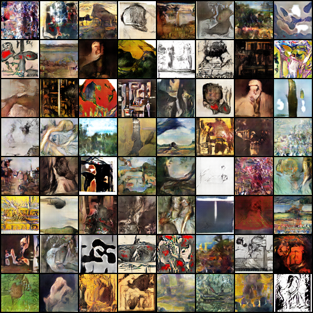

# ECE 285 HW2: Generating Paintings with a DCGAN on WikiArt

A DCGAN trained on the [WikiArt dataset](https://www.kaggle.com/datasets/steubk/wikiart)
(81,444 paintings, 27 styles) at 64x64 resolution, evaluated with Inception Score and FID
using PyTorch-Ignite. The write-up is in [`report/report.pdf`](report/report.pdf).

## Results (10k generated vs. 10k real images)

| Epoch | IS | FID (Ignite default) | FID (pool3, standard) |
|---|---|---|---|
| 10 | 2.31 | 0.068 | 71.0 |
| 20 | 2.81 | 0.037 | 36.1 |
| 30 | 3.04 | 0.037 | 30.1 |
| 40 | 3.05 | 0.027 | 24.5 |
| 50 | 3.02 | 0.022 | 22.0 |



## Files

| Path | Description |
|---|---|
| `models.py` | DCGAN generator and discriminator |
| `preprocess.py` | Resizes WikiArt images to 64x64 once and caches them as a `.npy` array |
| `data.py` | Dataset over the cached array (random horizontal flip) |
| `train.py` | Training loop. Saves losses, loss curves, per-epoch sample grids and checkpoints |
| `evaluate.py` | IS and FID with PyTorch-Ignite, following the [Ignite tutorial](https://pytorch-ignite.ai/blog/gan-evaluation-with-fid-and-is/) |
| `hw2_gan_kaggle.ipynb` | The full pipeline as one Kaggle notebook |
| `results/` | Final generator (`G_epoch050.pt`), loss history and curves, IS/FID scores, sample grid for each epoch |
| `report/` | LaTeX source, figures and PDF of the report |

## How to run

```bash
pip install -r requirements.txt

# 1. Download WikiArt from Kaggle and cache it at 64x64
kaggle datasets download steubk/wikiart -p data --unzip
python preprocess.py --root data --out data/wikiart64.npy

# 2. Train (50 epochs, ~1.8 min/epoch on a Tesla T4)
python train.py --data data/wikiart64.npy --epochs 50 --out outputs/run1

# 3. Evaluate
python evaluate.py --data data/wikiart64.npy --ckpt outputs/run1/G_final.pt --n 10000 --out outputs/run1/scores.json
```

To generate images with the trained model:

```python
import torch
from torchvision.utils import save_image
from models import Generator

G = Generator()
G.load_state_dict(torch.load("results/G_epoch050.pt", map_location="cpu"))
G.eval()
with torch.no_grad():
    save_image(G(torch.randn(64, 100, 1, 1)), "samples.png", nrow=8, normalize=True, value_range=(-1, 1))
```

Note: Ignite's default `FID()` uses Inception's 1000-d softmax outputs, so its values are much
smaller than the standard FID. `evaluate.py` reports both (`fid` and `fid_pool3`).
